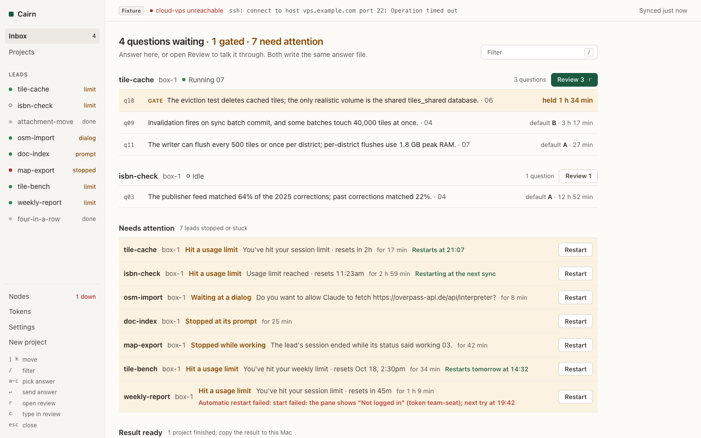
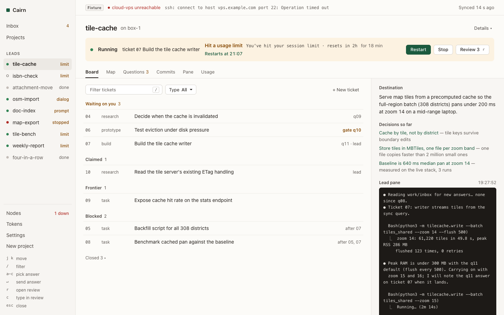
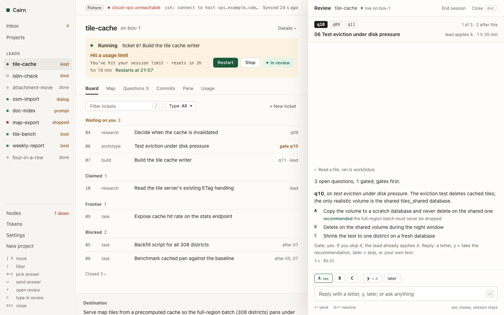

# Cairn

A local dashboard for [Claude Code](https://code.claude.com) leads that work unattended on machines you can ssh into.

A lead never waits on you. When it needs a decision it writes a question with a default, carries on with that default (or, for a gated question, with other work), and applies your answer when it comes. Cairn collects those questions from every machine into one Inbox, lets you answer them in a chat or with one click, restarts idle leads once you have answered, and pushes to your phone when something needs you.



> **Read this first.** Leads run `claude --dangerously-skip-permissions` with nobody watching. Run them only on disposable machines (a container, a VM, a spare server), never on your own laptop or anything with credentials you care about. See [the security model](docs/how-it-works.md#security-model).

## What you get

- **Inbox**: every open question from every project, with the default the lead is already applying. Answer with one click, or open **Review**, a chat with a review session on the node that walks the questions one at a time.
- **Project page**: tickets, decisions, the lead's latest activity, start, stop and restart, answering a Claude Code dialog the lead waits at, models for the lead and its subagents.
- **Results**: a finished lead writes `work/result.md`. **Get a copy** puts the project in `~/Downloads`; **Run it** opens a web result in your browser.
- **Needs attention**: a lead at a usage limit, waiting at a dialog, stopped at its prompt or stopped while working. After a limit, the hub moves the lead to the next token in the project's pool that is not limited; when every token is limited, it restarts the lead itself once the first limit resets.
- **Phone pushes** through any [ntfy](https://ntfy.sh) server: one per new question, finished result or lead that needs attention.
- **Usage**: tokens per model for each project, read from the session transcripts.

Files in each project's git repo are the channel between you and a lead (besides the pane the hub reads and a Claude Code dialog you can answer), so a node keeps working when the dashboard is closed or offline.

| Project page | Review chat |
|---|---|
|  |  |

The screenshots show the dashboard's built-in sample data: `?fixture=1` on a hub started with `hub/cairn serve --dev`. A hub started without `--dev` ignores `?fixture=`.

## Requirements

- **Hub**: macOS (it uses the Keychain, launchd and Finder), Python 3.12 or newer (3.11.4+ works; `hub/cairn` refuses an older one), git and ssh. No packages to install: the dashboard is vendored and needs no build step.
- **Node**: any Linux or macOS host you can ssh into with a key, with bash, Python 3.11+ (`cairn-node` refuses an older one), git, tmux 3.2+ and Claude Code.
- **A Claude login per node**: an OAuth token from `claude setup-token`, kept in your Keychain and handed to the node at each start, or a node signed in to its own account (a `node-login` token). A new sandbox is never signed in: **Sign in** on its Nodes row, or `hub/cairn sandbox login <name>`, runs `claude auth login` in it from your terminal.

## Quick start

Clone this repository and run every command below from its folder: `hub/cairn` and the scripts under `nodes/` run from the checkout, and there is nothing to install.

1. **Get a node.** Either a local sandbox in Docker: once the hub runs (step 2), **New sandbox** on the Nodes page builds the image, runs the container and adds it as a node, so step 4 is done for you (or `hub/cairn sandbox create box-1 --image slim --tokens main`). By hand:

   ```bash
   nodes/slim/run.sh --port 2222 --name cairn-slim
   ```

   or a fresh Debian VM or server, as root:

   ```bash
   nodes/debian/setup.sh "$(cat ~/.ssh/id_ed25519.pub)"
   ```

   Afterwards sshd accepts only `agent` with that key, so root and every other user lose ssh access to that host.

2. **Start the hub**, then sign your browser in to it:

   ```bash
   hub/cairn serve
   hub/cairn open      # in another terminal
   ```

   Every page and API call needs a sign-in cookie, which only the link `cairn open` opens hands out. Without it the hub answers 401 and says to run `cairn open`. The link holds the hub's secret (`~/.cairn/hub-secret`); `cairn serve` also prints it, so it is in `~/.cairn/serve.log` under the LaunchAgent.

3. **Add a token** on the Tokens page (paste the output of `claude setup-token`), or from a terminal, where the prompt hides it:

   ```bash
   hub/cairn token add main --kind oauth
   ```

   With a `node-login` token instead, sign the node in to its own account: for a sandbox, `hub/cairn sandbox login box-1`, which prints a link and waits for the code that link's page shows. The login lives in the sandbox's home volume, so **Recreate** (a new container from the current image) keeps it; Delete removes it.

4. **Add the node** on the Nodes page (or `hub/cairn node add box-1 --ssh agent@192.0.2.10 --tokens main`). The hub installs `~/.cairn/cairn-node` and the review skill there and checks the dependencies.

5. **Create a project** on the New project page: a name, a destination in a sentence or two, and optionally first tickets. Leave "Start the lead now" on.

Its first questions appear in the Inbox within a minute.

## Keep it running

```bash
hub/cairn service install     # a LaunchAgent: starts the hub at login and after a crash
hub/cairn service status
hub/cairn service uninstall
```

The log is `~/.cairn/serve.log`. Run `hub/cairn open` to open the dashboard signed in. Leads keep working on their nodes while the hub is stopped; it catches up on the next sync.

## Phone pushes

Settings → Notifications: give your ntfy server (`https://ntfy.sh` or your own) and press **Set up**. The hub creates a random topic, keeps it in the Keychain and shows it on that page only (and in `hub/cairn notify show`). Subscribe to it in the ntfy app, then press **Send test**. Anyone who knows the topic can read your pushes, so treat it like a password.

## Files in a project repo

```
LEAD.md                    the lead's standing rules (rendered at init)
work/map.md                destination, decisions so far, not yet specified, out of scope
work/tickets/NN-slug.md    tickets: research, prototype, grilling, task, build
work/adr/NNNN-slug.md      decision records
work/inbox/qNN.md          questions (the lead writes)
work/inbox/qNN.answer.md   answers (the dashboard writes)
work/status                working NN | idle | done
work/result.md             the handoff, written before done
```

## Layout

| path | what |
|---|---|
| `hub/cairn`, `hub/cairn_hub/` | the hub: CLI, API server, sync, auto-restart, mirror, notifications |
| `hub/cairn_hub/sandbox.py` | local Docker sandboxes: the registry, the guarded docker calls and the create job |
| `hub/ui/` | the dashboard (Preact, htm and marked, vendored); `?fixture=1` runs it on sample data under `hub/cairn serve --dev` |
| `node/cairn-node` | the single-file node script (standard-library Python) |
| `node/LEAD.md.tmpl`, `node/skills/cairn-review/` | the lead's rules and the review skill |
| `nodes/slim/`, `nodes/dev/`, `nodes/debian/` | the two Docker sandbox recipes (dev builds on slim) and a setup script for Debian hosts |

How it works, the file formats, the API and the security model: [docs/how-it-works.md](docs/how-it-works.md).

## Tests

```bash
python3 -m unittest discover -s node/tests
python3 -m unittest discover -s hub/tests
```

Both suites run offline: ssh, tmux, Docker, Claude Code and the Keychain are faked.

## Things learned the hard way

- Claude Code does not pass `CLAUDE_CODE_OAUTH_TOKEN` to the commands it runs, so nothing inside a session can start another session with your token. That is why the hub, not the review skill, restarts leads.
- `claude --continue` picks the newest conversation in the directory, which can be the review session. Leads use `--session-id` and `--resume`.
- A logged-out Claude keeps its tmux session open. `start` watches the pane for about 8 s and fails on "Not logged in".
- An agent cannot type `/exit`; an idle lead ends its own tmux session instead.
- A resumed lead does only what its resume prompt names, so the prompt names new tickets as well as answers.
- Tokens reach a node through a FIFO read by the pane's shell, never through argv: tmux keeps its first command line visible in `ps`.

## License

[MIT](LICENSE)
