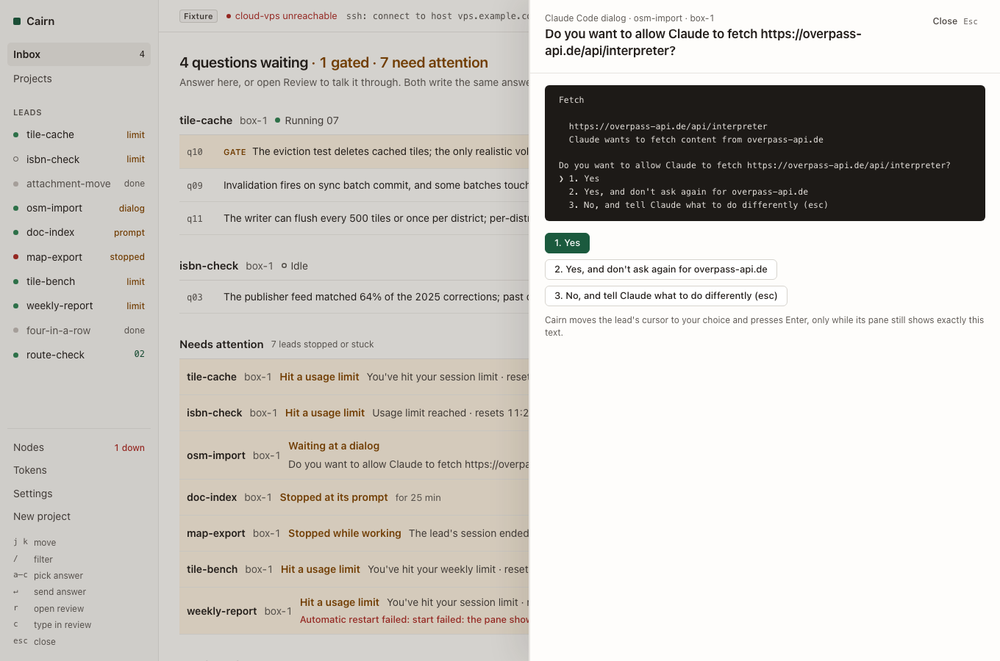

# How Cairn works

This is the reference for people who run Cairn or work on its code. It describes what the code does today. When this page and the code disagree, the code is right and this page needs a fix.

Contents:

- [Overview](#overview)
- [Security model](#security-model)
- [Files in a project repo](#files-in-a-project-repo)
- [The lead's loop](#the-leads-loop)
- [cairn-node commands](#cairn-node-commands)
- [The hub](#the-hub)
- [HTTP API](#http-api)
- [The cairn CLI](#the-cairn-cli)
- [Files the hub keeps](#files-the-hub-keeps)

## Overview

Cairn is a local dashboard for Claude Code leads. A lead is a Claude Code session that works on one project, unattended, in tmux, on a machine you reach over ssh. That machine is a **node**. The dashboard runs on your Mac and is called the **hub**. You are **the operator**.

Files in each project's git repo are the channel between a lead and the operator. The lead writes tickets, decisions, questions and a status line. The operator writes answers. Besides the files, the hub reads the lead's pane and can answer a Claude Code dialog the lead waits at by sending keys to the pane. Nothing else passes between them: no hook, no daemon on the node, no message API. A node keeps working when the hub is closed, and the hub catches up at its next sync.

A lead never waits for the operator. When it needs a decision it writes a question with a default, applies the default, and keeps going. A gated question is the exception: the lead skips the gated work until the answer arrives and takes other tickets. When the answer arrives it adjusts.

### The moving parts

```
  Mac: the hub (127.0.0.1:8770)                  node: any ssh host
 +--------------------------------+             +------------------------------------+
 | browser <--> cairn serve       |  ssh, JSON  | ~/.cairn/cairn-node                |
 |              sync every 30 s   | ----------> |                                    |
 |              auto-restart      |  token on   | tmux -L cairn                      |
 |              attention         |  stdin only |   <project>         the lead       |
 |              review chat <-----|------------>|   <project>-review  terminal review|
 |              Run it servers    |  claude -p, |                                    |
 | Keychain: tokens, ntfy topic   |  stream-json| project repo                       |
 | mirror/<node>/<project>.git <--|- git fetch -|   LEAD.md, work/...                |
 +--------------------------------+             +------------------------------------+
         |
         | ntfy push (questions, results, attention)
         v
       phone
```

- **The hub** (`hub/cairn serve`): a Python HTTP server on `127.0.0.1` that serves the dashboard and a JSON API. It asks every node for a snapshot every 30 seconds, restarts idle leads after answers, watches for leads that need the operator, mirrors every repo, and sends phone pushes. It runs only on macOS: it uses the Keychain, launchd, Finder and Terminal.
- **The node script** (`node/cairn-node`): one file of standard-library Python, installed by the hub at `~/.cairn/cairn-node` on each node. The hub runs it over ssh. Every command prints JSON. It reads project files into a snapshot, creates projects, starts and stops sessions in tmux, writes ticket changes and answer files, and reports token usage.
- **The lead**: `claude --dangerously-skip-permissions` in the tmux session `<project>` on the socket `tmux -L cairn`, in the project's repo. Its standing rules are the repo's `LEAD.md`.
- **The review chat**: a second Claude Code process in the same repo that walks the operator through the open questions one at a time and writes answer files. The dashboard runs it as `claude -p` with stream-json over ssh and shows it as a chat panel. The CLI can instead open it in a tmux session (`<project>-review`) and attach Terminal to it. Both run the `cairn-review` skill, installed on the node at `~/.claude/skills/cairn-review/SKILL.md`.
- **The mirror**: a bare git mirror of every project repo on the Mac, at `~/.cairn/mirror/<node>/<project>.git`. It is the backup. When a node dies, everything its leads committed is still on the Mac. **Get a copy** and **Run it** export from it.

Names: project names match `^[a-z0-9][a-z0-9-]{0,39}$`. Node names and token labels match `^[A-Za-z0-9][A-Za-z0-9._-]{0,39}$`.

## Security model

**Read this before you add a node.**

### Nodes must be disposable machines

A lead runs `claude --dangerously-skip-permissions` with nobody watching. It can run any command as the node's user, read every file that user can read, and reach every host that machine can reach. The gate rules in `LEAD.md` (ask before touching production, deleting outside the repo, pushing upstream, spending money or using credentials) are instructions to a model. They are not a security boundary.

So a node must be a machine you can lose: a container, a VM, a spare server. Never your own laptop. Never a machine that holds credentials you care about.

- Give the node user no cloud credentials, no production ssh keys and no tokens beyond the Claude login.
- The `slim` sandbox image and `nodes/debian/setup.sh` give the node user no sudo. The `dev` sandbox image gives `agent` passwordless sudo, so a lead can install packages and start services. A lead on a `dev` node can act as root inside its container: only the container separates it from the Docker host.
- The hub's ssh calls pass `-o ForwardAgent=no`, and so does the attach command of a terminal review (`ssh -t -a -o ForwardAgent=no …`), so a lead never reaches your ssh agent, whatever `~/.ssh/config` says.
- The hub connects to nodes over ssh. Nodes never need to connect to the hub, and the Mac needs no open port. A Docker sandbox on the Mac can still reach the hub's port, through `host.docker.internal`; every request it makes gets 403 with a wrong `Host` header, and 401 without the browser's sign-in cookie (see [The hub's own surface](#the-hubs-own-surface)).
- The hub records node host keys in `~/.cairn/known_hosts` on first contact (`StrictHostKeyChecking=accept-new`). A changed host key fails the connection. After you rebuild a node, delete its old line from that file.
- `nodes/slim/` builds a Docker sandbox node with an unprivileged user and key-only ssh on `127.0.0.1`. `nodes/dev/` builds on it and adds a toolchain and the sudo above. `nodes/debian/setup.sh` prepares a fresh Debian host.

### How login tokens are kept

A token is a Claude login for a node. There are two kinds:

| kind | secret | what the lead gets |
|---|---|---|
| `oauth` | the output of `claude setup-token` | the value in `CLAUDE_CODE_OAUTH_TOKEN` |
| `node-login` | none | nothing; the node uses its own Claude login (sign a sandbox in with **Sign in**, below) |

The secret of an `oauth` token lives only in the macOS Keychain, as a generic password with service `cairn` and the label as account. It is written with `security -i`, with the command on stdin, so it never appears in a process list. Every Keychain call times out after 30 seconds, so a locked Keychain waiting on a prompt fails the call instead of hanging it. No Keychain call runs under the lock that guards the JSON files: adding, renaming and removing tokens take a lock of their own (`.tokens.lock`), one change at a time, so a stalled Keychain holds up only other token changes, and a label's secret is never written by one change while another deletes it. `~/.cairn/tokens.json` holds the label, kind, account, date added, an expiry one year after adding, and the last four characters. Nothing else.

At each start the hub reads the secret from the Keychain and writes it as the first line of the ssh command's stdin. On the node:

1. `cairn-node` reads that line. A token with whitespace in it is refused.
2. It makes a private directory under `~/.cairn/run/` (mode 0700) and a FIFO in it (mode 0600).
3. It starts the tmux session with a small shell command. The shell reads one line from the FIFO, removes the FIFO, exports `CLAUDE_CODE_OAUTH_TOKEN` only when the line is not empty (and unsets it otherwise), then `exec`s claude.
4. `cairn-node` writes the token into the FIFO, waiting at most 10 seconds for the reader, then removes the directory.

A FIFO stores nothing on disk, so the token never sits in a file. It is never in any argv: tmux keeps a session's first command line visible to `ps`, which is why the FIFO exists. `cairn-node` also strips `CLAUDE_CODE_OAUTH_TOKEN` from the environment it gives the tmux server, and replaces the token with `***` in any pane text it returns in an error.

The review chat does not use tmux. `cairn-node chat` reads the token line from stdin one byte at a time, so the rest of stdin stays for claude, puts the token in claude's environment, and `exec`s claude. The hub replaces any text equal to the token with `***` before it becomes a chat event, and redacts tool inputs before it shortens them.

The hub never puts a token in argv, in a log line or in an API response. The API accepts a secret only in a POST body.

Two limits to keep in mind:

- The token is in the environment of the claude process on the node. Any process running as the node user can read it from there. Claude Code does not pass it on to the commands it runs, and `LEAD.md` and the review skill forbid printing the environment, but a determined agent could still find it. Treat every token as exposed to its nodes, and revoke it if a node is compromised.
- A token is used only on nodes whose `allowed_tokens` list names it. This is checked each time the token is sent (a start, a restart, a review, a chat), so a token taken off a node's list never reaches it again, whatever a project still names; that start is refused with 409. A project uses its chosen token, or else its node's first allowed one.

### The hub's own surface

- The server listens on `127.0.0.1` only, port 8770 by default.
- Every request must carry a `Host` header of `127.0.0.1:<port>` or `localhost:<port>`, or it gets 403. This blocks DNS rebinding.
- The hub keeps a secret in `~/.cairn/hub-secret` (mode 0600, `secrets.token_urlsafe(32)`), made on first use and the same across restarts. `cairn open` opens `http://127.0.0.1:<port>/?k=<secret>`. That request sets a cookie named `cairn-<port>` holding the secret (`HttpOnly`, `SameSite=Strict`, one year) and redirects to `/`, so the secret leaves the address bar.
- Every other request needs that cookie: without it, `/` and the static files answer 401 with a page that says to run `cairn open`, and every `/api` route answers 401 with ``{"error": "this browser is not signed in to the hub; run `cairn open` on the Mac"}``. The dashboard shows that as a banner until a request gets through. A wrong `?k=` is a 401 too.
- The dashboard page carries `<meta name="cairn-token">`, an HMAC-SHA256 of the secret. Every POST must send it in `X-Cairn-Token` and must have an `Origin` equal to `http://<Host>`. Otherwise the answer is 403. `GET /api/notify` needs the token too. It and the response to `POST /api/notify/setup` are the only ones with the ntfy topic. The token changes only when the secret does: a page opened before that, in a browser signed in again since, reads the new token from `/` once and retries.
- To sign every browser out, delete `~/.cairn/hub-secret` and restart the hub; run `cairn open` again afterwards.
- Every response carries `X-Frame-Options: DENY`. HTML pages carry `Content-Security-Policy: default-src 'self'; script-src 'self' 'sha256-…'; style-src 'self' 'unsafe-inline'; img-src 'self' data:; connect-src 'self'; object-src 'none'; base-uri 'none'; frame-ancestors 'none'`, with the hash of each inline script taken from the page as served (the import map is the only one). Every other response carries `Content-Security-Policy: frame-ancestors 'none'`. No page can frame the dashboard, and an injected inline script does not run.
- `POST /api/nodes` refuses (403) the ssh target `local`, a node that runs leads on the Mac itself, unless the hub runs with `CAIRN_ALLOW_LOCAL_NODE=1`. `cairn node add <name> --ssh local` in a terminal still adds one.
- POST bodies over 64 KB are refused.
- The dashboard renders lead-written markdown through an allowlist sanitizer. Raw HTML is escaped, images become text, and a link is kept only when its parsed URL is `http`, `https` or `mailto` (relative links resolve to the hub). A link to another origin opens in a new tab with `noopener noreferrer`.

What this stops: other web pages, which cannot read the cookie or the page; and a Docker sandbox, which reaches the port through `host.docker.internal` with any `Host` header it likes but has no cookie, so every request it makes gets 403 (a wrong `Host`) or 401 (no cookie). What it does not stop: a program on your Mac that runs as you can read `~/.cairn/hub-secret` or `~/.cairn/serve.log` (under the LaunchAgent the hub prints the sign-in link there at every start), sign in and do anything the dashboard does. The hub trusts your user account.

### Run it serves results on a separate origin

**Run it** serves a copied result with a read-only static file server on `127.0.0.1` at a free port. A different port is a different origin, so the result's scripts cannot read the hub's responses, cannot pass the Origin check on a POST, and cannot frame the dashboard. The result is still code written by an unattended agent and runs in your browser. Treat it like any web page you did not write. The server serves every file in the copied folder. It stops when you press Stop or when the hub exits.

### Get a copy writes only into a new folder

**Get a copy** exports one commit from the mirror with `git archive` and extracts it with Python's `data` tar filter. Links that point outside the folder are left out and listed. The folder is always new; an existing one is never overwritten. This needs Python 3.12, or 3.11.4 or later.

### The ntfy topic is a secret

Phone pushes go to an ntfy server at `<server>/<topic>`. Anyone who knows the topic can read your pushes and send fake ones. Pushes carry project names, question lines and result lines.

- Setup makes the topic: `cairn-` and 24 random URL-safe characters. It lives only in the Keychain (service `cairn`, account `cairn:ntfy-topic`; token labels cannot contain `:`, so it never collides with a token).
- `GET /api/notify`, the response to `POST /api/notify/setup` and `cairn notify show` are the only places it is shown. `GET /api/state` never contains it.
- Error texts never contain the push URL, because it holds the topic.
- Redirects from the server are refused, never followed.

On a public server such as `https://ntfy.sh` the topic is the only protection. A server you run yourself is better.

## Files in a project repo

```
LEAD.md                     the lead's standing rules, rendered from node/LEAD.md.tmpl at init
work/map.md                 destination, notes, decisions so far, not yet specified, out of scope
work/tickets/NN-slug.md     one ticket per file
work/adr/NNNN-slug.md       one decision record per file
work/inbox/qNN.md           a question; the lead writes it
work/inbox/qNN.answer.md    the answer; the dashboard or the review session writes it
work/status                 one line: working NN | idle | done
work/result.md              the handoff, written before done
```

`cairn-node init` creates the scaffold. It commits only the files it created, and leaves other files in an existing repo alone. Empty `tickets`, `adr` and `inbox` folders get a `.gitkeep`. Lead commits use the repo's git identity; when none is set, init sets `cairn lead <lead@cairn.local>` in the repo. Dashboard commits use `cairn dashboard <dashboard@cairn.local>`.

A file that cannot be parsed never breaks the snapshot. A ticket, question or decision record that cannot be parsed is skipped and named in the snapshot's `warnings`. An answer file that cannot be parsed still marks its question answered, and the warning names the question.

### LEAD.md

Rendered once, at init, with the project name, the destination, and the notes (`None.` when empty). Its sections are `## Destination`, `## Notes`, `## Files`, `## Tickets`, `## Asking the operator`, `## Gates`, `## Loop`, `## Safety` and `## Subagents`. The last line marks the template version:

```
<!-- cairn LEAD.md v3 -->
```

A file without the marker counts as version 1. **Update LEAD.md** re-renders it from a newer template (see [Update LEAD.md](#update-leadmd)).

### work/map.md

```markdown
# demo

## Destination

<one or two lines>

## Notes

<notes and skills for the lead, may be empty>

## Decisions so far

- [Pick a storage format](tickets/02-pick-a-storage-format.md) — SQLite, one file per project

## Not yet specified

## Out of scope

- [Mobile app](tickets/05-mobile-app.md) — desktop only for now
```

The snapshot reads the destination (the lines under `## Destination`, joined) and the bullet lines under `## Decisions so far`.

### Tickets: work/tickets/NN-slug.md

```markdown
---
id: 03
title: "Fix the import of empty files"
type: build
status: open
assignee:
blocked_by: [01, 02]
---
## Question

<what the ticket asks>

## Resolution

<appended when the ticket is closed>
```

- `type`: `research`, `prototype`, `grilling`, `task` or `build`.
- `status`: `open` or `closed`.
- `assignee`: empty means unclaimed. The lead and its subagents write `lead`.
- `blocked_by`: ticket ids, inline (`[01, 02]`) or as a block list.
- `title` is a double-quoted JSON string.
- Ids compare without leading zeros, so `3` and `03` are the same ticket.
- A new ticket takes the highest number in use plus one, counting the `NN-` prefix of every `.md` file in the folder.

The snapshot gives each ticket a `state`, in this order: `closed` when closed; `waiting` when an unanswered question names it; `claimed` when it has an assignee; `blocked` when any blocker is still open; otherwise `frontier`.

The dashboard can change tickets (see [`ticket`](#ticket-project)). It changes only open, unclaimed tickets.

### Decision records: work/adr/NNNN-slug.md

The first line is `# <title>`. Then context, decision and consequences, in any form.

### Questions: work/inbox/qNN.md

```markdown
---
id: q07
ticket: 03
gate: no
default: B
asked_at: 2026-10-17T14:02:00Z
---
<one line of context>

A. <option>
B. <option> (recommended: <reason>)
C. <option>
```

- 2 to 4 options, each a line `<capital letter>. <text>`.
- `ticket`: the ticket the question belongs to, or empty.
- `gate`: `yes` means the lead skips the gated work until the answer exists. `yes`, `true`, `y` and `1` count as yes.
- `default`: the recommended letter, which the lead applies at once.
- `asked_at`: UTC.
- The context is the first body line that is not an option.
- After the lead handles the answer, it adds `applied: <UTC time>` to this file. Only the lead writes question files.

A question is **unanswered** while `qNN.answer.md` does not exist. The Inbox shows the unanswered questions. A question answered there in the last minute, or in the review chat open for its project, stays in view. A grilling ticket asks its questions one file at a time.

### Answers: work/inbox/qNN.answer.md

```markdown
---
id: q07
choice: B
answered_at: 2026-10-17T15:10:00Z
---
<free text, may be empty>
```

`choice` is one of the question's letters, or `other`. `other` needs text in the body. The dashboard writes answer files without committing them; the lead commits them. The lead never edits an answer file.

### work/status

One line: `working NN`, `idle` or `done`. Init creates it empty. Anything that does not match is read as `unknown`.

### work/result.md

The handoff the operator reads when the work is done. The lead writes or refreshes it, and commits it, before it writes `done`.

```markdown
<One plain sentence saying what was made.>

## What was made

## How to use it

<exact commands>

## Key files

## Limits
```

The snapshot carries its first 4000 characters (with `…` added when cut) and the short sha of the last commit that changed it. When `work/result.md` itself is a symlink, a FIFO or any other non-regular file, it is not read. The check covers that last path component only: a `work` folder that is a symlink is followed.

## The lead's loop

The hub starts the lead with one of two prompts:

- First start: `Read LEAD.md and work the map.` with a new `--session-id <uuid>`.
- Every later start: `Read new answer files in work/inbox and check work/tickets for open tickets added while you were away (the dashboard can add them), then carry on per LEAD.md.` with `--resume <uuid>`. When Claude Code no longer has that conversation, the start is a first start again, with a new id.

The session id is stored on the node in `~/.cairn/state/<project>.started`. Cairn never uses `--continue`: it picks the newest conversation in the folder, which could be a review session.

`LEAD.md` then tells the lead to work like this:

1. **Read answers.** Before claiming each ticket, read every answer file whose question has no `applied` field. Commit new answer files as soon as it sees them. Adjust the affected work, note the answer on its ticket, then mark the question `applied`.
2. **Claim.** First resume any open ticket assigned to `lead`; it is left over from before a restart. Otherwise pick an open ticket with no assignee and no open blockers. Set `assignee: lead` before any other work. Write `working NN` to `work/status`.
3. **Work.** Do the ticket. Create new tickets for work it discovers. Record real design choices as ADRs.
4. **Resolve.** Append `## Resolution`, set `status: closed`, and add a line under `## Decisions so far` in the map.
5. **Ask, with a default, and keep going.** When it needs a decision, write `work/inbox/qNN.md`, apply the default, and carry on. With `gate: yes` it skips the gated work and takes other tickets. Gates are required before touching production, deleting anything outside the repo and scratch folders, pushing upstream, spending money, and using or creating credentials. It never waits in the terminal.
6. **Go idle.** When no ticket is assigned to it and no unclaimed ticket is workable, and only waiting items remain, it checks the answer files one last time. If an answer is unhandled it goes back to step 1. Otherwise it writes `idle` (or `done` when everything is closed and `work/result.md` is current), commits, and ends its own tmux session with `tmux -L cairn kill-session -t =<project>`.
7. **Restart.** The hub starts the lead again once there are answers it has not applied (see [Automatic restart after answers](#automatic-restart-after-answers)). The lead resumes its own conversation and reads the answers first.

Other rules in `LEAD.md`:

- Never run `git stash`, `git clean`, `git reset`, `git checkout` or `git restore` on `work/inbox`, or without a path. Answer files are untracked until the lead commits them, and these commands destroy them.
- Never print, log or commit environment variables.
- Subagents claim and resolve tickets the same way. Only the main lead writes `work/status`, reads or writes `work/inbox`, and runs tmux commands.

The dashboard can add tickets at any time, even after `done`. The lead checks `work/tickets/` on every start.

## cairn-node commands

`~/.cairn/cairn-node <command>` on the node. Every command except `chat` prints one JSON object on stdout and exits 0. On failure it prints `{"error": "<message>"}` and exits 1. Under Python 3.8 to 3.10 every command fails this way before it does anything; an older Python stops at a syntax error. The hub turns a node failure into HTTP 502, except where the API tables say otherwise.

| command | stdin | result |
|---|---|---|
| `snapshot` | none | the [snapshot](#the-snapshot) |
| `read <project> <relpath>` | none | `{"path", "content"}`. Refuses paths outside the repo and files over 2 MB. |
| `init <project>` | init object | `{"project", "path"}` |
| `start <project> [--model A] [--subagent-model A]` | token line | `{"session", "resumed", "session_id"}` |
| `stop <project>` | none | `{"stopped": bool}` |
| `review <project>` | token line | `{"session": "<project>-review", "attach": "tmux -L cairn attach -t <project>-review"}` |
| `pane <project> [--review]` | none | `{"lines": [...]}`, the last 60 lines of the lead's (or review's) pane |
| `ticket <project>` | one op | `{"id", "path", "commit"}` |
| `chat <project> [--resume] [--model A] [--subagent-model A]` | token line, then stream-json | one line `{"type": "cairn", "session_id", "resumed"}`, then claude's own output |
| `answer <project>` | `{"id", "choice", "note", "fingerprint"}`; `fingerprint` is optional | `{"id", "choice", "answered_at", "path"}`; refuses with the fresh `question` when `fingerprint` is not the question's |
| `relead <project>` | none | `{"version", "commit", "dropped"}` |
| `usage <project>` | none | the usage object |
| `dialog <project>` | none | `{"dialog": {"lines", "options": [{"n", "label"}], "selected", "fingerprint"}}`, or `{"dialog": null}` when the lead is not at a dialog |
| `dialog-answer <project> <fingerprint> <n>` | none | `{"answered", "label", "dialog"}`; refuses with the fresh `dialog` unless the pane still shows the dialog with that fingerprint |

The **token line** is the OAuth token, or an empty line for a `node-login` token.

Models: `A` is one of the Claude Code aliases `fable`, `opus`, `sonnet` or `haiku`. Any other value is refused.

### Node home

`~/.cairn/` on the node holds:

- `cairn-node` and `LEAD.md.tmpl`, installed by the hub.
- `projects.json`: `{"<project>": {"path": "/abs/repo"}}`.
- `projects.lock`: the `flock` every change to `projects.json` holds. An init reloads the registry under it, so two inits never lose each other's entry.
- `state/<project>.started`: `{"session_id", "started_at"}`, plus `"stopped": true` after a deliberate stop.
- `state/<project>.review.json`: the review chat's `{"session_id", "started_at"}`.
- `state/usage-<project>.json`: the usage cache.
- `run/`: short-lived FIFO folders for token delivery.

`cairn-node` runs with umask 077, so the files it makes, and those of the git, tmux and claude processes it starts, are private to the node user. Files that already exist keep their modes, except `projects.json`, the usage cache and `~/.claude.json`, which are rewritten and keep only the owner's permissions. When another user on the node must read something a lead makes (a web server serving a build folder, a bind mount read by another uid), have the lead `chmod` that path: put it in `LEAD.md`.

Before any claude start, `cairn-node` merges three settings into `~/.claude.json` without touching other keys: onboarding done, bypass-permissions mode accepted, and the repo folder trusted. The `claude` binary is found on `PATH`, else at `~/.local/bin/claude`. tmux must be 3.2 or later.

### init

```json
{"path": "/home/agent/work/demo",
 "repo": {"kind": "new", "url": "<git url, clone only>"},
 "destination": "<one or two lines>",
 "notes": "<may be empty>",
 "tickets": [{"title": "...", "type": "build", "question": "..."}]}
```

- `path` is optional; it defaults to `$HOME/work/<project>`. It must be absolute.
- `new` creates the folder and runs `git init` when there is no repo. `existing` needs a git repo at the path. `clone` needs an empty or missing folder and runs `git clone` (at most 600 seconds).
- Init refuses when `work/map.md` already exists, when the project name is registered at another path, and when the name ends in `-review`, since project `x`'s review session is `x-review`. A project registered under such a name before this rule stays usable.
- Init refuses a symlink at `work`, at its three folders and at every file it writes, and opens each file with `O_NOFOLLOW`, so a cloned or existing repo cannot make it write outside the repo.
- Ticket types default to `task`.
- When anything fails, init removes what it created. It unregisters the project only when this run added the entry, so an earlier registration of the same project stays, and the same init can run again.

### start, stop

`start` refuses when the session is already alive. It starts claude in tmux as described under [How login tokens are kept](#how-login-tokens-are-kept). With `--model`, claude gets `--model A`. The lead runs with `CLAUDE_CODE_SUBAGENT_MODEL=A` when `--subagent-model` is given, and with that variable unset otherwise, so a value in the node's own environment never leaks in.

After starting, it watches the pane for about 8 seconds (`CAIRN_START_WAIT`). It fails, kills the session and returns the last pane lines in `"pane"` when claude exits, or when the pane shows `Not logged in`, `Please run /login`, `Run /login`, `Invalid API key` or `OAuth token has expired` after the newest echo of this start's prompt (`❯ Read LEAD.md …`). A claude without a login stays alive at its prompt, so a live session alone proves nothing.

Only the lines after that echo count, because a resumed lead first replays its history, and the lead's own words there may quote those messages. Captures from Claude Code 2.1.304 (`node/tests/fixtures/login-panes/`) show the real failure there: as a `⎿ Not logged in · Please run /login` line under the echo, as the newest `●` line (`● Please run /login · API Error: 401 …`), or in the footer under the input box. When the echo is not on the pane, the last 15 lines count, as before cairn-node 0.4.5. A lead that ends its own session within the window has finished, not failed.

`stop` kills the session and marks the start marker `stopped`, so the hub does not report it as stopped while working. The next start clears the mark.

### review

Starts `<project>-review` in tmux, in the repo, running `claude --dangerously-skip-permissions --session-id <new uuid> "/cairn-review"`, with the same token handling. When that session is alive, it returns the attach line without starting another. The review skill ends its own session when it is done, so the next review starts fresh.

### chat

Reads the token line, runs `trust_project`, and prints `{"type": "cairn", "session_id", "resumed"}`. Then it `exec`s, in the repo:

```
claude -p --input-format stream-json --output-format stream-json --verbose \
  --dangerously-skip-permissions [--model A] (--session-id <new uuid> | --resume <uuid>)
```

`--resume` uses the id in `state/<project>.review.json` when claude saved that conversation (a matching `~/.claude/projects/*/<id>.jsonl` exists). Otherwise it starts fresh and `resumed` is `false`. A fresh start writes the file.

### ticket `<project>`

stdin is one op. Each op writes one ticket file and commits only the paths it changed, as `cairn: <op> ticket NN`. Ops on one repo are serialized by a lock file in the git folder (30-second wait). Commits run with `--no-verify` and no signing, try up to 5 times when another git process holds a lock, and count as done when HEAD already holds the content.

| op | fields | rule |
|---|---|---|
| `create` | `title`, `type`, `question`, `blocked_by` (optional) | next id, slug from the title, status open, no assignee |
| `close` | `id`, `resolution` | appends `## Resolution`, sets `status: closed`, adds `- [title](tickets/NN-slug.md) — <resolution>` under `## Decisions so far` in the map |
| `out-of-scope` | `id`, `reason` | the same, with `Out of scope: <reason>` as the resolution, and the map line under `## Out of scope` |
| `blockers` | `id`, `blocked_by` | replaces `blocked_by` |

`close`, `out-of-scope` and `blockers` refuse unless the ticket is open and unclaimed. `close` and `out-of-scope` refuse while `work/map.md` has uncommitted changes, because the lead also writes the map. `create` and `blockers` refuse unknown ids, a ticket blocking itself, and cycles. A refusal changes no file.

### answer `<project>`

Writes `work/inbox/<qNN>.answer.md` with `answered_at` set to now (UTC), the note as the body, and `O_EXCL`, so two answers can never overwrite each other. It refuses an unknown question, one already answered, a choice that is neither one of the question's letters nor `other`, `other` without a note, and a note over 4000 characters. It does not commit.

With `fingerprint`, the one the snapshot gave the question the operator saw, it also refuses when the question's `fingerprint` is now different, as when the lead rewrote `qNN.md` after the dashboard read it. That refusal carries the question as it is now in `"question"`. Without `fingerprint` it answers as before, so an older hub still works.

### relead `<project>`

Re-renders `LEAD.md` from the installed template. It keeps the project name, the text between `## Destination` and `## Notes`, and the text between `## Notes` and `## Files`, so notes may hold their own `## ` headings. It refuses when any of those three headings is missing. It commits only `LEAD.md` as `cairn: update LEAD.md to v<N>`. `dropped` lists headings of the old file that the new template lacks; their text is still in git history.

### usage `<project>`

Reads Claude Code's transcripts for the project: every `*.jsonl` under `~/.claude/projects/<slug>/`, subagent transcripts included. The slug is the repo path with every character other than letters and digits replaced by `-`; both the registered and the resolved path are tried. This covers the lead, review sessions and subagents.

For each assistant message it sums `input_tokens`, `output_tokens`, `cache_read_input_tokens` and `cache_creation_input_tokens` per model, once per message id, skipping `<synthetic>`. Active time adds up the gaps under 5 minutes between consecutive timestamps across all files. Results per file are cached by size and modification time.

```json
{"models": [{"model": "...", "input": 0, "output": 0, "cache_read": 0, "cache_write": 0, "messages": 0}],
 "sessions": 3, "first_at": "<ISO>", "last_at": "<ISO>", "active_minutes": 95, "files": 7}
```

Models are sorted by output tokens, largest first. `sessions` counts top-level transcript files.

### The snapshot

```json
{"node_version": "0.4.6",
 "lead_template_version": 3,
 "host": "box-1", "time": "<ISO UTC>",
 "free_ram_mb": 1234, "free_disk_mb": 56789,
 "deps": {"tmux": "3.3a", "git": "2.39.5", "python3": "3.11.2", "claude": "2.1.0"},
 "login": "yes",
 "projects": [{
   "name": "demo", "path": "/home/agent/work/demo",
   "status": "working 03",
   "lead": "alive",
   "lead_stopped": false,
   "lead_state": "working",
   "lead_note": null,
   "pane_last": "<the lead's latest meaningful pane line>",
   "lead_version": 3,
   "review": "none",
   "map": {"destination": "...", "decisions": ["- [title](tickets/02-x.md) — gist"]},
   "tickets": [{"id": "03", "title": "...", "type": "build", "status": "open", "assignee": "lead",
                "blocked_by": ["02"], "state": "claimed", "path": "work/tickets/03-x.md"}],
   "questions": [{"id": "q07", "ticket": "03", "gate": false, "default": "B", "asked_at": "...",
                  "context": "...", "options": ["A. ...", "B. ... (recommended: ...)"],
                  "answered": false, "choice": null, "answered_at": null, "applied": null,
                  "path": "work/inbox/q07.md", "fingerprint": "<sha256 hex>"}],
   "result": null, "result_sha": null,
   "adrs": [{"id": "0001", "title": "...", "path": "work/adr/0001-x.md"}],
   "commits": [{"sha": "abc1234", "date": "<ISO>", "subject": "..."}]
 }],
 "warnings": [{"warning": "demo: skipped work/tickets/09-x.md: frontmatter is not closed"}]}
```

- `status`: `working NN`, `idle`, `done` or `unknown`.
- `lead`: `alive` (the tmux session exists), `dead` (started before, no session now), `none` (never started) or `unknown` (tmux did not answer within 3 seconds or is missing, which proves neither).
- `review`: `alive` when the `<project>-review` tmux session exists, else `none`.
- `commits`: the last 10.
- A missing dependency is `null`.
- `login` (cairn-node 0.4.6): whether claude on the node has a login of its own, from `claude auth status --json` run without `CLAUDE_CODE_OAUTH_TOKEN`, as a lead's pane is. `yes` when it says `loggedIn: true`; `no` when it says `false`; `unknown` when claude is missing, cannot be run or takes over 10 seconds, or its output is not that JSON. On macOS `false` reads as `unknown`, because over ssh claude reads its login from the Keychain, and a Keychain it cannot read there may still hold one; this has not been tried on a macOS node. The hub reads a missing or other value as `unknown`. On a sandbox that is not signed in the check took about 0.2 seconds; whether it touches the network for a stored login was not checked, since that needs a real sign-in.
- A question's `fingerprint` is the sha256 hex of its `context` and `options` joined by newlines, as the snapshot gives them. [`answer`](#answer-project) checks it.
- `pane_last`, `lead_state` and `lead_note` are `null` unless the lead is alive. They come from one capture of the pane's last 40 lines; a capture that takes over 3 seconds gives `null`.
- Every pane capture (`pane`, `dialog`, `pane_last`, `lead_note`) replaces anything shaped like an Anthropic token (`sk-ant-` and what follows) with `***`. Other secrets a lead prints still reach the dashboard.

`lead_state` reads from the lead's last `●` line down, and the `limit` test skips the lead's message itself. The `dialog` test reads the last 12 lines, whatever they hold:

| state | when |
|---|---|
| `working` | a line has `esc to interrupt`, or a spinner line such as `✻ Thinking… (` |
| `limit` | a `⎿` line matches the usage-limit pattern, or a line has both `limit` and `reset`. `lead_note` is the line that carries the reset time, from the limit lines or a `continue automatically at 11pm` line: one with a zone first, then a `resets` line. A clock time without a zone gets the node's zone after it (`11pm (UTC)`), since Claude Code prints the node's clock. Only when no line has a time is it the limit line itself. |
| `dialog` | there is no empty input box, and the last 12 lines show a numbered choice under `❯` (`❯ 1.`) or `Do you want to` / `Would you like to`. `lead_note` is the last line ending in `?`. |
| `prompt` | the empty input box is showing, and no background agent of the lead's session (`~/.claude/projects/<repo folder>/<session id>/subagents/*.jsonl`) wrote in the last 15 minutes; when one did, the lead is waiting for its agents and the state is `working` |
| `unknown` | none of these |

**Answering a dialog.** `cairn-node dialog` captures 200 lines of the lead pane and decides the state with the rule above on the last 40, as the snapshot does. The dialog's `lines` run from below its top border (a rule line after the last `●` line, else the line after that `●` line) to the end of the pane. `options` is the numbered list holding the `❯` marker, `selected` the option under it, and `fingerprint` the sha256 of its non-blank lines without Claude Code's auto-deny countdown, which changes every second and disappears at the first key. `dialog-answer` sends keys only while the pane shows the dialog with the fingerprint the operator read. It moves the marker with Up and Down, one tmux `send-keys` per key, checks that the marker reached the chosen option and the text is otherwise unchanged, then presses Enter. One answer per lead runs at a time, and the same dialog text is refused for 15 seconds after an answer, so a dialog Claude Code has not repainted yet never gets a second Enter. It never sends number keys and never touches the `-review` session. The `--dangerously-skip-permissions` flag does not skip these built-in checks, which is why the dashboard offers this.

## The hub

Start it with `hub/cairn serve`, then run `hub/cairn open`, which opens the dashboard with a link that signs the browser in (see [The hub's own surface](#the-hubs-own-surface)). To keep the hub running, see [`cairn service`](#the-cairn-cli). `hub/cairn` stops at once, with a message, under a Python older than 3.11.4.

### Sync

Each node has its own thread. Every 30 seconds it runs `cairn-node snapshot` over ssh (25-second timeout) and keeps the last good snapshot. When a sync fails, the node shows as unreachable with the error, and the last good snapshot stays for display. New entries in `nodes.json`, for example from `cairn node add`, are picked up within 30 seconds.

A lead owns `cairn-node` on its node and can make it print anything, so the hub parses every snapshot once, before anything reads it: the sync, the CLI, the installer and the sandbox checks alike. Every field the hub or the dashboard reads is coerced to its type (a wrong or missing one gets the empty value). A project without a valid name or an absolute `path`, or with a name seen before, is dropped and named in the snapshot's `warnings`, and the hub logs that note once. A reply that is not an object with a `projects` list is a failed sync. The output of any node command is cut off past 32 MB, and the review chat's stream past 32 MB per line.

When a node is removed (through the API, or by a removal outside the hub that its next sync notices), the hub forgets its snapshot, its attention episodes and its automatic-restart memory, so a node added again under the same name starts clean.

After each good snapshot the hub runs, in order: automatic restart after answers, the attention check, notifications, and queuing the mirror. A failure in one step is logged and does not stop the others.

`POST /api/sync` syncs every node now, in parallel. Actions that change a node (a ticket, an answer, a restart) sync that node right after. The dashboard polls `GET /api/state` every 10 seconds.

ssh options for every call, except the terminal review's attach command and the sandbox sign-in command:

```
-o BatchMode=yes -o ConnectTimeout=5 -o ForwardAgent=no
-o ControlMaster=auto -o ControlPath=~/.cairn/cm-%C -o ControlPersist=120
-o ServerAliveInterval=15 -o ServerAliveCountMax=4
-o UserKnownHostsFile=~/.cairn/known_hosts -o StrictHostKeyChecking=accept-new
```

plus `-p <port>` when the node has one. ssh never prompts, so the node must accept your key without a passphrase prompt (an ssh agent works).

### Automatic restart after answers

After each sync the hub looks at every project. It starts the lead once when all of these hold:

- `lead` is `dead` (it was started before and its session is gone; `unknown` never counts),
- no terminal review session is alive and no review chat is live,
- `status` is `idle` or `unknown`,
- at least one question is answered but not `applied`.

The hub remembers, in memory, the set of answered-but-unapplied question ids it last started for, per project. It never starts again for the same set, so a lead that dies without applying its answers is not restarted in a loop. A failed start is logged and not retried for that set. When the project's token cannot be used, the project is skipped and the reason logged once. A hub restart clears this memory.

The review skill never restarts the lead itself. Claude Code does not pass `CLAUDE_CODE_OAUTH_TOKEN` to the commands it runs, so a lead started from inside a review would have no login.

### Mirror

Each sync queues every project for the mirror. One background worker runs git, so a slow clone never holds up a sync. Get a copy waits for the mirror queue to empty, up to 120 seconds.

- When the node's newest commit differs from the mirror's, the worker runs `git fetch --prune <url> +refs/*:refs/*` into `~/.cairn/mirror/<node>/<project>.git`. The URL is `ssh://<ssh>[:port]/<path>`, with the same ssh options.
- The first time, it runs `git clone --mirror` into a `.partial` folder and moves it into place, so a hub killed mid-clone leaves nothing that looks like a mirror.
- Mirrors keep a reflog of every ref change and never expire it (`core.logAllRefUpdates=always`, `gc.reflogExpire=never`, `gc.reflogExpireUnreachable=never`). A lead that resets or force-pushes cannot make the mirror lose commits.
- A failing project waits 30 seconds, then twice as long after each further failure, up to 30 minutes. `POST /api/sync` and Get a copy skip the wait.
- A mirror failure never fails the sync. It shows in the project's `mirror.error`.

### Attention

The hub watches for leads that need the operator. Each one is an **episode** with a kind:

| kind | words in the dashboard | counts |
|---|---|---|
| `limit` | Hit a usage limit | at once, for a live lead whose `lead_state` is `limit` |
| `dialog` | Waiting at a dialog | at once, for a live lead whose `lead_state` is `dialog` |
| `prompt` | Stopped at its prompt | after 10 minutes in that state |
| `crashed` | Stopped while working | at once, when `lead` is `dead`, `status` starts with `working`, the lead was not stopped on purpose, and no review chat is live |

A live lead whose pane capture failed keeps its current episode, and so does a lead reported `unknown` (tmux did not answer); neither opens one. `since` is when the hub first saw the episode. It is kept in memory, so a hub restart starts it again.

Episodes show in an Inbox group, **Needs attention**, and on the project's lead bar, each with a **Restart** button. A `dialog` episode also has **Review dialog**: a drawer that shows the dialog as the pane does, with one button per option. Choosing one sends it through `POST /api/dialog`. When the dialog changed in the meantime nothing is sent and the drawer shows the new one.



Restart stops the lead when it is alive, then starts it again: it resumes its conversation with the resume prompt, the project's token and its models.

**Automatic restart after a usage limit.** For a `limit` episode the hub reads the reset time from the note. It understands:

- `resets in 2h`, `resets in 45m`, `resets in 1h 20m`
- `resets 3pm`, `resets 3:30pm`, `resets at 15:00`
- `continue automatically at 11pm`, `Continuing automatically at 6:30am` (Claude Code's limit menu)
- each with an optional zone: `(Europe/Lisbon)`, `(UTC)`, `(GMT)`

Without a zone (a node older than 0.3.2) the Mac's own zone is used, daylight saving included. A clock time up to 5 hours in the past has already reset. A time further in the past means tomorrow.

A reset more than 8 days away counts as 8 days, so a garbled `resets in 99999h` cannot pin a token. When the time cannot be read, the hub assumes the limit lasts 5 hours from when it first saw it. A limit the pane shows never counts as over sooner than 5 minutes from when the hub saw it, even when the reset it names has passed: a time read in the wrong zone would otherwise rotate the lead at every sync.

**Token rotation.** A project can have a pool of tokens in preference order (`cairn project tokens`, or Token pool under Details on the project page). Without one, its pool is its token alone. On a new `limit` episode the hub records the active token's limit in `~/.cairn/limits.json`, shared by every project, then picks the next token. An `oauth` token's limit is kept under its label, since it is one account wherever it runs. A `node-login` limit is kept under `node-login@<node>`: it is that node's own login, so it covers every `node-login` label on that node and none on another node.

1. It tries the tokens after the active one in pool order, wrapping round, with the active one last. It skips any token the node does not allow (the active one included), any token missing from `tokens.json`, and any kind other than `oauth` and `node-login`. It also skips every `node-login` token other than the active one while the node's snapshot says `login: no` (the login check): rotation never moves a project to a login the node does not have, and a restart on the same token is unchanged. `unknown` skips nothing. The check uses the snapshot of the sync that runs the switch, and the log says `<node>/<project>: node <node> is not signed in to Claude, so <labels> cannot run there; not switching to it`. When nothing is left, the restart fails with that reason, and a failure caused by the check says to sign the node in.
2. The first one that is not limited wins. The hub makes it the project's token and restarts the lead at once. The log says `<node>/<project> switched from <old> to <new> after a usage limit`, and the attention line says "Switched to <new>".
3. When every token is limited, the hub waits for the one whose limit ends first (ties go to pool order). `resume_at` is that time plus 2 minutes, and the dashboard shows "Restarts at 15:02 on <label>". At that time the hub makes it the project's token, then restarts.

A limit whose end has passed counts as over. The token is chosen again when a wait ends, so a token removed from the pool or the node meanwhile is skipped; if every token is limited at that moment, the wait moves to the next first reset.

After any successful automatic restart, on a new token or the same one, a limit is a new episode for the token the lead now runs on, and the hub moves on again. It counts only in a snapshot whose `time` is more than 2 minutes after the restart finished: an earlier snapshot may have been captured before the restart (a second sync of the same node), or the resumed pane may still show the old limit.

With a one-token pool, `resume_at` is the reset plus 2 minutes, and the dashboard shows "Restarts at 15:02". At the first sync after that time the hub restarts the lead and logs it.

A restart that fails is tried again every 5 minutes, 3 attempts in all; `resume_error` and `resume_attempts` show how it went. The attempts go on when the failed restart left the lead stopped (its stop worked and its start did not), although the snapshot then reads as a deliberate stop. After the third failure `resume_at` becomes `null` and the hub pushes once. After a success `resume_at` becomes `null`. No automatic restart happens while a review chat is live.

`cairn token clear-limit`, `POST /api/tokens/clear-limit` and **Clear** on the Tokens page forget a recorded limit, so rotation may pick that token again. A `node-login` limit needs its node.

### Notifications

The hub pushes to an ntfy server when something needs the operator. Set it up on the Settings page or with `cairn notify setup --server <url>`. There is no default server: the first setup must name one. Setup creates the topic when there is none and saves the settings. Only a missing topic is created; when the Keychain cannot be read, setup reports the error and never replaces the topic. A failed Keychain read is retried after 60 seconds.

**Events:**

| event | key in `notified.json` | title | body | priority | tag |
|---|---|---|---|---|---|
| an unanswered question | `q:<node>/<project>/<qid>` | `<project>: question <qid>` | the question's context line | `high` for a gate, else `default` | `question` |
| a result ready | `r:<node>/<project>/<result sha>` | `<project>: result ready` | the result's first line | `default` | `package` |
| a lead that needs attention | `a:<node>/<project>/<kind>`, plus `/<token>` for a limit on a token | `<project>: needs attention` | the kind in words and the note; after a token switch, `<project> switched to <new>: <old> hit its limit (resets 23:00)` | `high` | `warning` |
| an automatic restart that gave up | the attention key plus `/failed` | `<project>: needs attention` | `Automatic restart failed after 3 attempts: <error>` | `high` | `warning` |

A limit pushes once for each token that hits it, so every switch of a cascade and its final wait each push.

The push is `POST <server>/<topic>` with headers `Title`, `Priority` and `Tags`, and a one-line body of at most 300 characters. Timeout 10 seconds.

**Once-only rules:**

- An item is pushed once. Its key is written to `~/.cairn/notified.json` after delivery, so a hub restart does not repeat it.
- At most 10 items are pushed per node per sync; the rest go at the next syncs. Pushes go out without holding the hub's lock, and an item being pushed is skipped by an overlapping sync of the same node.
- A question or result key is removed once its project, or for a question its id, has left the snapshot, so a project made again under an old name pushes its questions again.
- An attention key is removed when its project, still in the snapshot, has no episode of that kind open any more. A prompt episode under 10 minutes still counts as open. The next episode pushes again.
- The first sync of a node the file has never seen records what is already there without pushing. So does the first sync after setup, and the first sync after notifications are turned back on: what piled up meanwhile is recorded, not pushed.
- When notifications are off or not set up, nothing is sent or recorded.

**Delivery check.** A push counts as delivered only when ntfy answers 200 with a JSON body whose `event` is `message`. A redirect, a 200 from something that is not ntfy, or a network error leaves the item pending, and the rest of that sync's items wait for the next sync. A 401, 403 or 429 (access refused, rate limited) is treated the same way: tried again next sync. Any other 4xx answer means ntfy refused this one item: it is recorded as handled and logged without the URL, so it never blocks later items. The last error shows on the Settings page and as a warning dot on Settings in the sidebar.

**Send test** sends `Cairn: test` and records nothing.

### Models

Each project can set a model for the lead and one for its subagents: `fable`, `opus`, `sonnet`, `haiku`, or the account default (`null`). Both are saved in the hub's `projects.json` and used at the next start: by the dashboard, the CLI, the automatic restarts and the review chat. A change while the lead runs shows "Used at the next start".

The hub refuses (409) to start a lead or a chat with a model set on a node whose cairn-node is older than 0.2.0, because that node would reject the flags. **Update cairn-node** on the Nodes page fixes that. The Nodes page offers it whenever a node runs an older cairn-node than the hub carries.

### Get a copy and Result ready

A project has a **result ready** when all of these hold:

- `status` is `done`,
- `work/result.md` exists and is committed (`result` and `result_sha` are set),
- that result commit has not been copied yet.

"Copied" compares `result_sha` with the `copied_result_sha` the last Get a copy recorded, by prefix, because short shas grow with the repo. For a copy made before that field existed, the hub checks in the mirror whether the copied commit contains the result commit. So a dashboard commit after the result, such as a new ticket or Update LEAD.md, does not make the result ready again. A rewritten result does. The hub computes `result_ready`; the dashboard only reads it.

The project page shows a **Result** card with the rendered `result.md` when the file exists. The Inbox has one **Result ready** row per such project, after the questions. The row leaves the Inbox once that result is copied.

**Get a copy:**

1. Syncs the node now, with the mirror fetch forced.
2. Refuses, copying nothing, unless the node answered, the project has a commit, the mirror finished within 120 seconds, and the mirror holds exactly the node's newest commit without an error.
3. Exports that commit, files only and no history, to `~/Downloads/<project>`. When that folder exists it uses `<project>-YYYY-MM-DD`, then `<project>-YYYY-MM-DD-2`, `-3` and so on. It never overwrites.
4. Opens the folder in Finder and records `copied_sha`, `copied_to` and `copied_result_sha`.

A failed `git archive` creates no folder and reports git's message. A failed extraction removes its folder and reports that error.

### Run it

For web results. **Run it** serves the copied folder on its own `127.0.0.1` port and opens it in the default browser.

- A server already running for the copied folder is opened again, without a sync.
- Otherwise the existing copy is reused when it holds the node's current result (`copied_result_sha` against `result_sha`; without a result, `copied_sha` against the newest commit), or when the node is unreachable. In every other case Get a copy runs first.
- The folder must have `index.html` at its top, or the answer is 409.
- **Stop** ends the server. All such servers end with the hub.

### Update LEAD.md

`LEAD.md` is rendered once, at init, so older projects keep older rules. When a project's `lead_version` is below its node's `lead_template_version`, the project page shows "LEAD.md is from an older template" with **Update LEAD.md**. That runs [`cairn-node relead`](#relead-project). A running lead may not read `LEAD.md` again before its next start.

### Review chat

**Review**, on the Inbox or a project page, opens a chat panel on the right. The page behind stays usable.

The hub keeps one chat per project, in memory. Starting runs `cairn-node chat <project>` over ssh with pipes, writes the token line, and on a fresh start sends the message `/cairn-review chat`. A reader thread turns claude's stream-json into chat events. The raw stream never reaches the browser.

**Events** (each has `seq` from 1 and `at`):

| kind | fields | from |
|---|---|---|
| `user` | `text` | a message the operator sent (the opening `/cairn-review chat` is not shown) |
| `text` | `text` (markdown) | an assistant text block |
| `tool` | `name`, `summary` | a tool call: a Bash command's first line, a file path, or compact JSON, at most 160 characters |
| `turn` | `ok`, `seconds`, `cost_usd` | the end of a turn |
| `answered` | `id`, `choice` | after each turn the hub syncs the node and reports questions answered since the chat started |
| `state` | `state`, `detail` | every state change |

**States:** `starting`, then `working` (a turn runs) and `waiting` (the operator's turn), back and forth, then `ended` or `error`. Both of the last two are final.

| final state | detail |
|---|---|
| `ended` | `finished`: the skill ended with the line `Review finished.` (which the hub strips), or no unanswered question is left after a turn |
| `ended` | `closed`: the operator pressed End session |
| `ended` | `idle`: 20 minutes after it became the operator's turn |
| `ended` | `exited`: claude exited by itself |
| `error` | the last stderr line of ssh or claude, a failed turn (named as a login failure when it is one), or no output for 10 minutes while starting or working |

Entering a final state closes claude's stdin, waits up to 10 seconds, then kills it. A chat that ended `idle` or `closed` is resumed by the next Review, which continues the same conversation and keeps the earlier events. Any other start is fresh.

The review skill sends one question per message, starting with the id in bold (`**q07**`). The panel offers the option letters, `y` (take the recommendation) and `later` (skip; the lead keeps the default) as chips, and a text box (Enter sends, Shift+Enter makes a new line). Free text becomes `choice: other` with the text as the note. The skill writes each answer file right after each answer. When answers were written, the panel says the lead restarts within 30 seconds.

**One-click answers.** Each Inbox question row also takes an answer directly: the option letters (the default is selected), an optional note, and Answer. While a project's chat is live, the chat owns its questions and one-click answers for it are refused.

Keyboard: `j` and `k` move between rows, `/` focuses the filter, `r` opens Review for the focused project, `c` focuses the chat box, letters and Enter answer the open Inbox question, and Esc closes the newest panel, drawer or form. Esc on the chat panel hides it without ending the chat.

The CLI's `cairn review` uses the terminal path instead: `cairn-node review` starts the tmux session `<project>-review`, and the hub opens Terminal on `ssh -t -a -o ForwardAgent=no [-p <port>] -o UserKnownHostsFile=~/.cairn/known_hosts -o StrictHostKeyChecking=accept-new <ssh target> tmux -L cairn attach -t <project>-review`. The skill ends that session itself when it is done.

### Usage

The project page's **Usage** tab runs [`cairn-node usage`](#usage-project) when opened. It shows a table with a row per model (input, output, cache read, cache write, messages), totals, sessions, active time, and first and last activity. It shows tokens only: seats are subscriptions, so no cost is shown.

### Sandboxes

A sandbox is a node the hub runs itself, as a Docker container on the Mac, from one of two images:

| image | tag | built from |
|---|---|---|
| `slim` | `cairn-slim:0.1` | `nodes/slim/` |
| `dev` | `cairn-dev:0.1` | `nodes/dev/`, on top of `slim` |

The registry is `~/.cairn/sandboxes.json`. For a sandbox named `<name>` the container is `cairn-<name>` and its volumes are `cairn-<name>-home` (on `/home/agent`) and `cairn-<name>-hostkeys` (on `/etc/ssh/hostkeys`). The node's ssh target is `agent@127.0.0.1` on the sandbox's port.

**Create** runs as a job with these phases:

| phase | what happens |
|---|---|
| `building` | only when an image is missing: `docker build` for it, base image first, 600 seconds at most in all. The job keeps the last 20 output lines in `log_tail`. |
| `starting` | when `cairn-<name>` exists and is labelled for this sandbox, it is reused and started if it is not running; a container with that name and no such label is refused. Otherwise the hub picks a port, creates both volumes with the label, refuses a volume that existed without it, runs the container (below), and removes the port's old line from `~/.cairn/known_hosts`, since a new container brings its own host key. Either way the sandbox is recorded in `sandboxes.json`. |
| `waiting` | ssh to the sandbox must answer within 60 seconds |
| `adding` | the node is added as with [`POST /api/nodes`](#nodes), with the job's allowed tokens, then synced. A node of that name with the same ssh target and port is kept as it is; one with another target fails the job. |
| `done`, `failed` | final; a failure sets `error` |

The container runs as:

```
docker run -d --name cairn-<name> --restart unless-stopped --label cairn.sandbox=<name>
  -p 127.0.0.1:<port>:22 -v cairn-<name>-home:/home/agent -v cairn-<name>-hostkeys:/etc/ssh/hostkeys
  -v <pubkey>:/etc/cairn/authorized_key:ro --cap-drop NET_RAW --cap-drop MKNOD --pids-limit 4096
  [--security-opt no-new-privileges] [--memory <MB>m] [--cpus <N>] cairn-<image>:0.1
```

- The hardening flags are those of `nodes/slim/run.sh`. `no-new-privileges` is added for `slim` only: the `dev` image's sudo is setuid, which that option blocks. sshd needs Docker's other default capabilities.

- `<pubkey>` is the first of `~/.ssh/id_ed25519.pub` and `~/.ssh/id_rsa.pub`. Without either, create is refused.
- The port is the first one from 2222 to 2299 that no container publishes (running or not), no other sandbox or running job holds, no node on `127.0.0.1` or `localhost` uses, and that the hub can bind on `127.0.0.1`.
- Memory is a whole number of MB, at least 1024. Left out, there is no cap. CPUs are a number from 1 to the CPUs Docker reports.

Create is refused while a job for the name runs, while the sandbox is being stopped or deleted, and when a node of that name exists, unless the last job for the name failed: then create runs again and reuses what the failed job made.

**The touch rule.** The hub changes an existing container or volume only through start, stop, remove and volume remove, and only for a sandbox in `sandboxes.json`. Docker object names come from the registry entry, never from the request. Before any of these, the container (when it exists) must carry the label `cairn.sandbox=<name>`, and each existing volume must carry it too. An adopted sandbox needs instead a container with exactly the recorded name that publishes 22/tcp on the recorded port, and its volumes are not checked. Anything else is refused with 409, and Docker is left alone.

- **Start** needs the container. It runs `docker start`, then waits up to 20 seconds for ssh, so the sync right after sees the node.
- **Stop** needs the container too, and runs `docker stop`.
- **Stop** and **Delete** are refused while a create job for the name runs and while another stop or delete of it runs. Both are refused (409) while a lead or review is alive on the node. While the container runs and the node cannot be checked (unreachable, not synced, or a lead reported `unknown`), they are refused with `"unchecked"` in the 409, unless `force` is given; the Nodes page then offers **Stop anyway** or **Delete anyway**. `force` never overrides a live lead. When the node record is gone but the container runs, the hub asks the sandbox for a snapshot itself (15 seconds) and refuses only when that shows a live lead or review.
- **Delete** needs the node name typed again (`confirm`). It removes the container and both volumes (one already gone counts as removed), the node with its `projects.json` entries, the port's line in `known_hosts`, and the registry entry, and the hub forgets what it kept for the node. The mirror on the Mac stays.
- **Recreate** removes the container and runs a new one from the image as it is now, with the same `docker run` arguments as create (one function builds both): the same name, label, port, both volumes, the hardening flags, memory and CPUs. The home volume keeps the node's own Claude login and every repo; the host-keys volume keeps the host key, so `known_hosts` needs no change. It is refused as Stop is (a create job, another stop or delete, a live lead, or an unchecked running node without `force`), for an adopted sandbox whose image is not `slim` or `dev`, and, before anything is removed, when either volume, the image or the public key is missing (`docker run` would make a lost volume again, empty and unlabelled). When the new container fails to start, the old one is already gone and the volumes stay; the error says so, and Recreate again runs the container, since a missing container is simply run. It never builds the image: rebuild it yourself first to pick up a newer Claude Code.
- **Sign in** shows the command that signs the sandbox's claude in to its own account, with a Copy button: `ssh -t -a -o ForwardAgent=no -p <port> -o UserKnownHostsFile=~/.cairn/known_hosts -o StrictHostKeyChecking=accept-new agent@127.0.0.1 'PATH="$PATH:$HOME/.local/bin" claude auth login'`. `cairn sandbox login <name>` runs the same command in the terminal. Claude Code prints a link; the operator opens it, signs in, and pastes the code that page shows back into the terminal. The link and the code pass between the terminal, the browser and the sandbox only, never through the hub. In a headless container `claude auth login` cannot open a browser, so it always takes this route. The panel says whether the node is signed in now, from the snapshot's `login`. Nobody has completed a real sign-in through it in a test.
- **Adopt** (CLI only) records an existing container for an existing node: by default `cairn-<node>`, which must publish 22/tcp on the node's port and mount `<container>-home` and `<container>-hostkeys`. Nothing in Docker changes.

A node whose sandbox container is stopped on purpose (Docker state `exited` or `created`, read at most 10 seconds earlier) is not ssh-ed at sync. It shows `"error": "sandbox stopped"` and `"stopped": true`. When Docker cannot be asked, the node is synced as usual.

A sandbox whose node record is gone, for example after `cairn node rm`, stays in `sandboxes.json`. The Nodes page lists it with Delete; a create with the same name reuses its container.

Docker errors map to HTTP statuses: Docker not running or not installed is 503, a docker call over its time limit (30 seconds; a build, 600 seconds in all) is 504, and any other failed docker call is 502.

### The dashboard

Pages: **Inbox** (questions, Needs attention, Result ready), **Projects**, **Nodes**, **Tokens**, **Settings**, and **New project**.

- **New project** asks for a name (checked as you type), a node, the repo (new, an existing path, or a git URL to clone; the path defaults to `$HOME/work/<name>` on the node), a destination, notes, optional first tickets, a token allowed on that node, the lead and subagent models, and whether to start the lead now.
- **Project page**: the lead bar (state, latest pane line, Start, Stop, Restart, and Review dialog when the lead waits at a dialog), the Result card, tabs for Board, Map, Questions, Commits, Pane and Usage, and Details (token, models, mirror, Update LEAD.md). The ticket drawer offers Close, Out of scope and Edit blockers on open, unclaimed tickets, and says why when they are unavailable.
- **Nodes**: reachability, last sync, free RAM and disk, dependency versions (missing ones highlighted; `claude … · not signed in` when the snapshot's `login` is `no`, highlighted when the node allows a `node-login` token), allowed tokens, projects, Add node, Update cairn-node, Remove. When Docker runs, **New sandbox** asks for a name, the image, memory, CPUs and allowed tokens, and shows the job's phase and build output, with Retry after a failure. A sandbox row carries a Sandbox chip with its image, the container's state, CPU and memory, and Start or Stop, Delete, Sign in and Recreate in place of Remove. Delete asks for the name to be typed; Recreate asks once and offers Recreate anyway when the node cannot be checked.
- **Tokens**: label, kind, account, last four characters, expiry, nodes, which live projects use it, and each recorded usage limit (per node for a `node-login` token) with **Clear**. Add, rename, change nodes, delete (blocked while in use; when a node that may run the token cannot be checked, it asks again before deleting with force).
- **Settings**: notification server, on and off, Set up, Send test, last error and last sent, the subscribe details (server and topic) with a copy button, and a line on `cairn service install`.

A hub started with `cairn serve --dev` (or `CAIRN_DEV=1`) serves `hub/ui/fixtures/` and marks its page with `<meta name="cairn-dev" content="1">`. Only on such a page does `?fixture=1` run the dashboard on sample data, under a full-width banner; every write goes to an in-memory copy. Without `--dev` the fixtures are 404 and the page ignores `?fixture=`. A lead's state reported `unknown` shows as **Unknown** with a faint ring, not as a dead lead.

### Logs

The hub logs to stdout: at start, the address and the sign-in link (which holds the hub secret); one line per automatic restart (`autostart:`), per restart after a limit (`attention:`), per refused push (`notify:`), and per project dropped from a snapshot (`sync:`). Under the LaunchAgent, stdout and stderr go to `~/.cairn/serve.log`, which starts afresh at hub start once it is past 5 MB. Tokens never appear in the log; treat the log as you treat `hub-secret`.

At start the hub sets `~/.cairn` to mode 0700, whatever made it. When it cannot bind its port it prints one line and exits 0, so launchd does not restart it in a loop. On SIGTERM or Ctrl-C it ends every chat and every Run it server.

## HTTP API

All routes are on `http://127.0.0.1:<port>` and speak JSON.

**Rules for every request:**

- The `Host` header must be `127.0.0.1:<port>` or `localhost:<port>`. Otherwise 403 `bad host`.
- The request must carry the sign-in cookie that `cairn open` hands out (see [The hub's own surface](#the-hubs-own-surface)). Otherwise 401, on every route, with the error ``this browser is not signed in to the hub; run `cairn open` on the Mac``.
- POST: the `Origin` header must be `http://<Host>`, and `X-Cairn-Token` must equal the token from the page's `<meta name="cairn-token">`, derived from the hub secret. Otherwise 403 `bad origin` or `bad token`.
- POST bodies are JSON objects of at most 64 KB. Otherwise 413 `body too large` or 400 `invalid JSON` / `body must be an object`.
- Errors are `{"error": "<message>"}`, with more fields where a table says so. 400 is a bad request, 401 a browser that is not signed in, 404 an unknown node, chat or route, or a project Get a copy or Run it cannot find, 409 a refusal because of the current state, 500 a Keychain or hub failure, and 502 a node that cannot be reached or that refused the command. The sandbox routes add 503 (Docker not running) and 504 (a docker call timed out), and 502 for a failed docker call.
- `node` is a node name from `nodes.json`; `project` is a project name on that node.

### Reading

| route | query | result |
|---|---|---|
| `GET /api/state` | | the [state object](#the-state-object) |
| `GET /api/file` | `node`, `project`, `path` | `{"path", "content"}` from `cairn-node read` |
| `GET /api/pane` | `node`, `project`, `review=1`? | `{"lines": [...]}` from `cairn-node pane`; 502 when the session is not alive |
| `GET /api/usage` | `node`, `project` | the usage object from `cairn-node usage` |
| `GET /api/dialog` | `node`, `project` | `{"dialog": ... \| null}` from `cairn-node dialog`; 409 for a node older than cairn-node 0.4.0 |
| `GET /api/sandboxes` | | the [sandboxes object](#sandboxes-1); 200 with `"docker": false` and the error when Docker is not running |
| `GET /api/ssh-hosts` | | `{"hosts": [...]}`: concrete `Host` names from `~/.ssh/config` and the files its `Include` lines name, without wildcards or negations |
| `GET /api/notify` | | `{"configured", "enabled", "server", "topic", "last_error", "last_sent_at"}`. Needs `X-Cairn-Token` (403 without). It and `POST /api/notify/setup` are the only responses with the topic. |
| `GET /api/chat` | `node`, `project`, `after`? | the [chat object](#the-chat-object) with events after `seq` `after`; 404 when the project has had no chat |
| `GET /api/chat/events` | `node`, `project`, `after`? | `text/event-stream`, below |

`GET /api/chat/events` sends each event as `id: <seq>` and `data: <json>`, and `: keepalive` every 15 seconds. A `Last-Event-ID` header wins over `after`. The stream stays open after the chat ends. It closes when a newer chat for the project replaces this one, and the client reconnects.

### Leads

| route | body | result | refusals |
|---|---|---|---|
| `POST /api/start` | `{"node", "project"}` | `{"session", "resumed", "session_id"}` | 409 token unusable or models on an old node; 502 the node refused (session alive, no login) |
| `POST /api/stop` | `{"node", "project"}` | `{"stopped": bool}` | 502 |
| `POST /api/restart` | `{"node", "project"}` | the start result | 409 while a review chat is live; 409 token or models; 502 |
| `POST /api/dialog` | `{"node", "project", "fingerprint", "n"}` | `{"answered", "label", "dialog"}`, then one sync of the node | 409 while a review chat is live; 409 with `dialog` when the dialog changed or `n` is not an option; 409 on a node older than 0.4.0; 502 |
| `POST /api/review` | `{"node", "project"}` | `{"attach": "<ssh command>"}`; opens Terminal on it | 409 token; 502 |
| `POST /api/lead/update` | `{"node", "project"}` | `{"version", "commit", "dropped"}` | 502 when a heading is missing |
| `POST /api/sync` | `{}` | the state object, without `chats` | |

Start, restart and the review chat use the project's token and models. Restart resolves both before it stops the lead, so a token problem never leaves the lead stopped. A token the node no longer allows is a 409.

### Questions and the review chat

| route | body | result | refusals |
|---|---|---|---|
| `POST /api/answer` | `{"node", "project", "id", "choice", "note"?, "fingerprint"?}` | `{"id", "choice", "answered_at", "path"}`, then the node is synced | 400 a `fingerprint` that is not a sha256 hex; 409 while the project's chat is live; 409 when the node refuses the answer; 409 with `question`, the question as it is now, when its `fingerprint` changed, and the node is synced; 502 ssh trouble |
| `POST /api/chat/start` | `{"node", "project", "resume"?: bool}` | the chat object; a live chat is returned as it is | 409 the last chat is still closing; 409 token or models; 502 |
| `POST /api/chat/send` | `{"node", "project", "text"}` | `{"seq"}` | 400 text empty or over 8000 characters; 404 no chat; 409 unless the state is `waiting` |
| `POST /api/chat/end` | `{"node", "project"}` | the chat object | 404 no chat |

The dashboard's one-click answer sends the `fingerprint` the snapshot gave the question it showed, and leaves it out when the snapshot has none (a node older than 0.4.3). On the 409 with `question` it shows the new text and answers nothing.

### Projects and tickets

| route | body | result | refusals |
|---|---|---|---|
| `POST /api/projects` | `{"node", "project", "path"?, "repo": {"kind", "url"?}, "destination", "notes"?, "tickets"?: [{"title", "type", "question"}], "token"?, "model"?, "subagent_model"?, "start": bool}` | `{"project", "path", "started", "start_error"}` | 400 bad fields, a name ending in `-review`, or a token not allowed on the node; 404 node; 502 init failed |
| `POST /api/projects/token` | `{"node", "project", "token"?, "tokens"?: []}`: the active token, the pool in preference order, or both; `[]` drops the pool | `{"node", "project", "token", "tokens"}`; used at the next start. The active token is put first in the pool when the pool lacks it | 400 unknown or not allowed on the node, a label twice, neither field |
| `POST /api/projects/models` | `{"node", "project", "model", "subagent_model"}`, each an alias or `null` | `{"model", "subagent_model"}`; used at the next start | 400 any other value |
| `POST /api/projects/copy` | `{"node", "project"}` | `{"path", "sha", "skipped": [...]}` | 502 node unreachable; 404 no such project; 409 no commit yet, or the mirror still busy after 120 s; 502 the mirror does not hold the newest commit, or the export failed; 500 Python without safe tar extraction |
| `POST /api/run` | `{"node", "project"}` | `{"url", "path"}`; opens the browser | 409 no `index.html` at the top of the copy; the Get a copy refusals |
| `POST /api/run/stop` | `{"node", "project"}` | `{"stopped": bool}` | |
| `POST /api/tickets` | `{"node", "project", "op", ...op fields}` | `{"id", "path", "commit"}`, then the node is synced | 400 unknown op; 502 the node refused (claimed, closed, cycle, map has changes) |

A project created through `POST /api/projects` gets a fresh `projects.json` entry: a name reused for a new project inherits nothing. With `"start": true` a failed start is reported in `start_error`, not as an error status.

### Nodes

| route | body | result | refusals |
|---|---|---|---|
| `POST /api/nodes` | `{"name", "ssh", "port"?, "allowed_tokens": []}` | `{"node", "check": {"deps", "host", "free_ram_mb", "free_disk_mb"}}` | 400 bad name, ssh target, port or unknown labels; 403 `ssh` is `local`, unless the hub runs with `CAIRN_ALLOW_LOCAL_NODE=1`; 409 name exists; 502 install failed |
| `POST /api/nodes/tokens` | `{"name", "allowed_tokens": []}` | `{"node", "allowed_tokens"}` | 400 unknown labels; 404 |
| `POST /api/nodes/update` | `{"name"}` | `{"node", "node_version"}` | 404; 502 |
| `POST /api/nodes/remove` | `{"name", "force"?: true}` | `{"removed"}` | 404; 409 while a lead or review is alive there; 409 with `"unchecked": ["<node>"]` when the node is unreachable, not synced yet or reports a lead `unknown`, unless `force` |

Adding a node copies `cairn-node` and `LEAD.md.tmpl` to `~/.cairn/` and the review skill to `~/.claude/skills/cairn-review/` on it, runs a snapshot, and saves the node only when that works. Update reinstalls the same three files. Remove forgets the node, its `projects.json` entries and its node-login limit, and the hub drops its snapshot, attention episodes and automatic-restart memory. The machine itself is not touched.

### Sandboxes

| route | body | result | refusals |
|---|---|---|---|
| `POST /api/sandboxes` | `{"name", "image": "slim" \| "dev", "memory_mb"?, "cpus"?, "allowed_tokens"?: []}` | `{"job": <job>}` at once; the job runs on its own thread | 400 bad name, image, memory or CPUs, or unknown labels; 409 a job for the name runs, the sandbox is being stopped or deleted, or the node exists; 502; 503; 504. Failures after the job starts (no public key, no free port, build, ssh) end the job `failed` instead |
| `POST /api/sandboxes/start` | `{"node"}` | `{"node", "state"}`, then the node is synced | 409 not a sandbox this hub manages, the touch rule, or the container is gone; 502; 503; 504 |
| `POST /api/sandboxes/stop` | `{"node", "force"?: true}` | `{"node", "state"}`; the node is synced before the live check and after | 409 a job or another stop or delete runs, the touch rule, the container is gone, or a lead or review is alive; 409 with `"unchecked": ["<node>"]` when the container runs and the node cannot be checked, unless `force`; 502; 503; 504 |
| `POST /api/sandboxes/recreate` | `{"node", "force"?: true}` | `{"node", "state"}`; the node is synced before the live check and after | the stop refusals except a missing container; 409 an adopted sandbox of an unknown image, or the image or public key is missing; 502 the new container did not start (the old one is gone, the volumes stay; Recreate again) |
| `POST /api/sandboxes/remove` | `{"node", "confirm", "force"?: true}` | `{"removed", "mirror": "<path>" \| null}`; `mirror` is the kept mirror folder | 400 `confirm` is not the node name; the stop refusals except a missing container |

`state` is Docker's container status, such as `running` or `exited`. Sandboxes are described under [Sandboxes](#sandboxes) in The hub.

The sandboxes object:

```json
{"docker": true, "error": null, "images": {"slim": bool, "dev": bool}, "cpus_max": 8,
 "sandboxes": [{"node", "container", "image", "port", "memory_mb", "cpus", "adopted": bool, "created",
                "state": "<Docker state> | missing", "cpu_pct", "mem_used_mb", "mem_limit_mb", "login_command"}],
 "jobs": [{"node", "phase", "error", "log_tail": [...], "started_at", "finished_at"}]}
```

`images` says which tags exist. `login_command` is the Sign in command for the sandbox's port, as one shell-quoted string. `cpu_pct` and `mem_used_mb` are set only for a running container, from `docker stats`, read at most 8 seconds earlier; `mem_limit_mb` only when the sandbox has a memory cap. `jobs` holds every create job since the hub started, a finished one included, until a delete or a new job for the name replaces it.

### Tokens

| route | body | result | refusals |
|---|---|---|---|
| `POST /api/tokens` | `{"label", "kind", "account"?, "secret"?, "nodes"?: [], "replace"?: true}` | the public token entry | 400 bad label, kind, or node names, or a secret under 8 characters; 409 the label exists (without `replace`); 500 Keychain |
| `POST /api/tokens/update` | `{"label", "new_label"?, "account"?, "nodes"?: []}` | the public entry under its final label | 404; 400 bad label; 409 the new label exists |
| `POST /api/tokens/remove` | `{"label", "force"?: true}` | `{"removed"}` | 404; 409 while a live lead or review uses it; 409 with `"unchecked": [<nodes>]` when a node that allows the token, or has a project naming it, cannot be checked now, unless `force` |
| `POST /api/tokens/clear-limit` | `{"label", "node"?}` | `{"label", "node", "cleared": bool}`; `cleared` is false when there was no limit | 400 `node` missing for a `node-login` token; 404 unknown token or node |

- `kind` is `oauth` or `node-login`. `secret` is required for `oauth` and ignored for `node-login`.
- `nodes` adds the label to those nodes' allowed lists. In an update it is the whole list: the label leaves every node not named.
- `"replace": true` replaces the secret, kind and account of an existing label and keeps its nodes and projects. Use it when a token expires, and to move a label of a kind this hub no longer supports to `oauth`. Starting a project whose token has such a kind is refused with 409 and that advice.
- A rename moves the Keychain item and updates every reference in `nodes.json` and `projects.json`. The steps are ordered so a crash at any point leaves a usable token.
- Removing a token syncs every node first and checks what each answers now. A deliberately stopped sandbox runs nothing and counts as checked. `force` deletes past the nodes that cannot be checked; a live lead still refuses. The token's references and its recorded limit go first and its Keychain item last, so a failure on the way never leaves a label without its secret. Projects that used it fall back to their node's first allowed token.
- Replacing an `oauth` token with `node-login` under the same label deletes its Keychain item.

### Notifications

| route | body | result | refusals |
|---|---|---|---|
| `POST /api/notify/setup` | `{"server"?, "enabled"?: bool}` | the same shape as `GET /api/notify` | 400 no server yet, or a server that is not an http(s) URL with a host and no spaces, query or fragment; 500 Keychain unreadable |
| `POST /api/notify/test` | `{}` | `{"ok": true}` | 409 not set up; 502 ntfy unreachable, redirected, not ntfy, or refused the push |

### The state object

```json
{"hub_version": "0.5.0",
 "synced_at": "<newest sync, ISO>",
 "nodes": [{"name", "ssh", "port", "allowed_tokens": [], "node_version", "update_available": bool,
            "sandbox": bool, "ok": bool, "error": "<text>" | null, "stopped": bool,
            "synced_at", "snapshot": <snapshot> | null}],
 "tokens": [{"label", "kind", "account", "last4", "expires", "in_use": ["<node>/<project>"],
             "limits": [{"node": "<node>" | null, "until", "known"}]}],
 "projects": {"<node>/<project>": {
     "token": "<label, resolved>", "tokens": ["<label>", ...], "limits": {"<label>": {"until", "known"}},
     "model", "subagent_model",
     "copied_sha", "copied_to", "copied_result_sha",
     "result_ready": bool,
     "attention": null | {"kind", "since", "note", "resume_at", "resume_error", "resume_attempts",
                          "token", "until", "known", "switch_to", "switched_to"},
     "running_url": "<Run it URL>" | null,
     "mirror": null | {"path", "sha", "synced_at", "error"}}},
 "notify": {"configured", "enabled", "last_error"},
 "chats": [{"node", "project", "state", "detail"}]}
```

`hub_version` is the hub's own version, the `VERSION` in `hub/cairn_hub/__init__.py`; `hub/cairn --version` prints it too. `in_use` lists projects whose lead or review is alive and that use the token. A token's `limits` are its recorded limits that have not ended: one with `node` null for an `oauth` token, one per node that allows it for a `node-login` token. A project's `tokens` is its pool, `[token]` without one; `limits` holds only the pool's tokens whose limit has not ended, a `node-login` one read under its node. In `attention`, `token` is the token that hit the limit, `until` and `known` its limit, `switch_to` the token the hub restarts the lead on (null for the same one), and `switched_to` the token it moved to. `snapshot` is the node's last good one, kept while the node is unreachable. `sandbox` is true for a node in `sandboxes.json`; `stopped` is true while its container is stopped on purpose, and then the node is not ssh-ed.

### The chat object

```json
{"node", "project", "state", "detail", "session_id", "started_at", "events": [...]}
```

## The cairn CLI

`hub/cairn <command>`. It works with or without a running hub; it reads and writes the same files, and a file lock (`.state.lock`, `.notify.lock`, `.tokens.lock`) around each read-modify-write keeps the two from losing each other's changes. Errors print `cairn: <message>` on stderr and exit 1. A failed `cairn sandbox create` prints its `failed` phase and the last build lines instead, and a usage error exits 2.

| command | does |
|---|---|
| `cairn --version` | prints the hub's version, `cairn 0.5.0` |
| `cairn serve [--port 8770] [--dev]` | runs the hub on `127.0.0.1` and prints the sign-in link; `--dev` (or `CAIRN_DEV=1`) also serves `ui/fixtures/` for `?fixture=` |
| `cairn open [--port 8770]` | prints the sign-in link and opens it in the default browser, signing it in to the hub; warns when nothing listens on the port |
| `cairn service install [--dry-run]` | writes and loads the LaunchAgent, below |
| `cairn service uninstall [--dry-run]` | unloads it and removes the plist |
| `cairn service status` | `installed · running`, or what is missing |
| `cairn token add <label> [--kind oauth\|node-login] [--account A]` | for `oauth`, prompts for the token with hidden input; stores it in the Keychain. Adding over an existing label replaces its secret and keeps its nodes and projects. |
| `cairn token ls` | labels, kinds, accounts, last four, expiry, nodes; never secrets |
| `cairn token rm <label> [--force]` | asks every node first; refused while a live lead or review uses it, and while a node that may run it cannot be checked unless `--force` |
| `cairn token clear-limit <label> [--node N]` | forgets the token's recorded usage limit; a `node-login` token needs `--node` |
| `cairn node add <name> --ssh <target> [--port N] [--tokens a,b]` | installs on the node, checks it, saves it, prints host, free RAM and disk, and dependency versions (`MISSING` when absent) |
| `cairn node ls` | each node with its ssh target and reachability |
| `cairn node tokens <name> <a,b>` | sets the allowed tokens; `""` for none |
| `cairn node update <name>` | reinstalls cairn-node, the template and the review skill |
| `cairn node rm <name> [--force]` | forgets the node; `--force` when it is unreachable |
| `cairn sandbox ls` | each sandbox with its image, container state, port, CPU and memory; fails when Docker is not running |
| `cairn sandbox create <name> --image slim\|dev [--memory MB] [--cpus N] [--tokens a,b]` | runs the create job in the terminal and prints each phase; on failure, the last build lines |
| `cairn sandbox start <name>` | starts the container |
| `cairn sandbox stop <name> [--force]` | stops the container; asks the node for a snapshot first, for the live check; `--force` when the node cannot be checked |
| `cairn sandbox recreate <name> [--force]` | a new container from the current image on the same port and volumes; the home volume, with the node's Claude login, stays; `--force` when the node cannot be checked |
| `cairn sandbox login <name>` | runs `claude auth login` in the sandbox over `ssh -t` in this terminal: open the link it prints, sign in, paste the code back |
| `cairn sandbox rm <name> [--yes] [--force]` | deletes the container, both volumes and the node, and keeps the mirror; asks for the name to be typed, or takes `--yes` (required without a terminal); `--force` when the node cannot be checked |
| `cairn sandbox adopt <node> [--container C]` | records an existing container for an existing node; changes nothing in Docker |
| `cairn init <node> <project> --destination "..." [--notes N] [--path P] [--repo new\|existing\|clone] [--url U] [--token L] [--model A] [--subagent-model A]` | creates a project; does not start the lead; refuses a name ending in `-review` |
| `cairn project token <node> <project> <label>` | sets the project's token |
| `cairn project tokens <node> <project> <a,b,c>` | sets the token pool in preference order; `""` for the active token alone |
| `cairn project models <node> <project> [--model A] [--subagent-model A]` | sets both models; a flag left out means the account default |
| `cairn ticket <node> <project> <create\|close\|out-of-scope\|blockers> [--title --type --question --id --resolution --reason --blocked-by a,b]` | one ticket op |
| `cairn start <node> <project>` | starts the lead with its saved token and models |
| `cairn stop <node> <project>` | stops the lead |
| `cairn review <node> <project> [--no-terminal]` | starts the terminal review and opens Terminal on it; prints the attach command |
| `cairn lead update <node> <project>` | Update LEAD.md |
| `cairn notify setup [--server URL]` | creates the topic if missing and saves the server |
| `cairn notify show` | prints the server, the topic and on or off, for subscribing |
| `cairn notify test` | sends a test push |
| `cairn notify on\|off` | switches pushes on or off; turned on again, the next sync records what piled up meanwhile without pushing it |

Get a copy, Run it, answers, Restart, Review dialog, Usage and the review chat are dashboard-only. Get a copy, Run it and the review chat depend on the running hub's mirror, servers or chats.

### The LaunchAgent

`cairn service install` writes `~/Library/LaunchAgents/com.coldlabs.cairn.plist` and runs `launchctl bootout`, then `launchctl bootstrap gui/<uid>` (retried, because bootstrap right after bootout can fail). The agent:

- runs `<python> <repo>/hub/cairn serve --port 8770` in the repo folder, where `<python>` is the Python that ran `cairn service install`;
- starts at login (`RunAtLoad`) and after a crash (`KeepAlive: {SuccessfulExit: false}`), but not after a clean exit such as a busy port;
- sets `PATH` to `/usr/local/bin:/opt/homebrew/bin:/usr/bin:/bin:/usr/sbin:/sbin`;
- writes stdout and stderr to `~/.cairn/serve.log`.

Install refuses when something else already listens on `127.0.0.1:8770` and the agent is not loaded, for example a `cairn serve` in a terminal. Run install again after you move the repo or change Python.

## Files the hub keeps

Everything lives in `~/.cairn/` on the Mac. Set `CAIRN_HOME` to use another folder. The folder is mode 0700; the hub sets that at every start. JSON files are written atomically with mode 0600.

| path | holds |
|---|---|
| `nodes.json` | `{"<node>": {"ssh": "<alias or user@host>", "port": N \| null, "allowed_tokens": ["<label>"]}}` |
| `tokens.json` | `{"<label>": {"kind", "account", "added", "expires", "last4"}}`; never a secret |
| `projects.json` | `{"<node>/<project>": {"token"?, "tokens"?, "model"?, "subagent_model"?, "copied_sha"?, "copied_to"?, "copied_result_sha"?}}`; `token` is the active token, `tokens` the pool in preference order (it always holds `token`); every writer but project creation, which makes a fresh entry, keeps the keys it does not change |
| `sandboxes.json` | `{"<node>": {"container", "image": "slim" \| "dev" \| null, "port", "memory_mb", "cpus", "created", "adopted": bool}}`: the sandboxes this hub manages, under [the touch rule](#sandboxes) |
| `limits.json` | `{"<label>" or "node-login@<node>": {"since", "until", "known", "note"}}`: each `oauth` token's last usage limit, and each node's own login's; `known` is false when the end is the 5-hour guess. An entry whose `until` has passed is over and is dropped when the next limit is recorded. A rename moves the entry, and removing the token or the node drops it |
| `settings.json` | `{"notify": {"server", "enabled", "configured"}}` |
| `notified.json` | `{"<key>": "<ISO sent>", "_nodes": {"<node>": "<ISO first seen>"}}`; the keys are listed under [Notifications](#notifications) |
| `known_hosts` | node host keys, recorded on first contact |
| `hub-secret` | the sign-in secret (mode 0600); the browser's cookie holds it and the POST token is derived from it. Delete it and restart the hub to sign every browser out |
| `.state.lock`, `.notify.lock`, `.tokens.lock` | the file locks the hub and the CLI take around each change of the JSON files (`.notify.lock` for `settings.json` and `notified.json`; `.tokens.lock` around a whole token add, rename or removal, Keychain calls included) |
| `cm-*` | ssh connection-sharing sockets (kept 120 seconds after the last use) |
| `mirror/<node>/<project>.git` | the bare mirrors |
| `serve.log` | the LaunchAgent's log; it holds the sign-in link, so it is as sensitive as `hub-secret` |
| `local-node/` | `cairn-node` for a node whose `ssh` is `local`; for development and tests only |

Outside `~/.cairn/`:

- **Keychain**, service `cairn`: one item per `oauth` token (account = the label), and the ntfy topic (account `cairn:ntfy-topic`).
- `~/Library/LaunchAgents/com.coldlabs.cairn.plist`: the LaunchAgent.
- `~/Downloads/<project>…`: the folders Get a copy made. The hub never deletes them.

Held only in memory, and lost on a hub restart: the last snapshots, chats and their events, attention episodes and their `since` times, the automatic-restart memory, mirror states and backoff, the Run it servers, and the sandbox create jobs.
